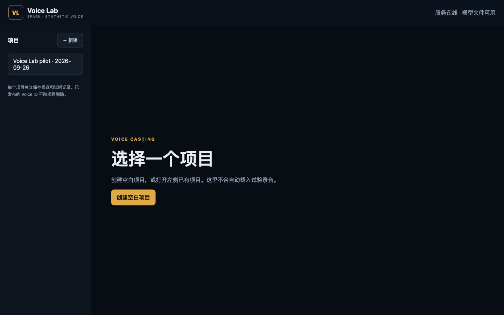

# Spark Voice Lab project cutover — 2026-09-27

## Scope and result

Implemented the approved [project-scoped Voice Lab plan](../roadmap/2026-09-26-spark-voice-lab-projects-plan.md)
on specialist branch `codex/h3-ref2va-gateway`. No Plotloom authoring code was
changed, no Plotloom director contact occurred, and this branch was not merged
or pushed. The deployed wheel SHA-256 is
`9e96b01e06488d5278d7c96fb1770c5ddb7e2fd6a86330550a05f93bfffbf11e`.

The old pilot data was preserved under named project
`vp_935e1b10b48b44daa761251f75828314`. After the cutover, opening `/`
shows only a project chooser; it does not select or play the pilot. The retained
pilot has two completed candidates and one completed clone trial.

Before migration, the Voice Lab service was verified idle, stopped, and the
exact data root was copied to
`/home/wjmao/services/plotloom-voice-lab/backups/2026-09-27-pre-project-cutover`.
Its six-file SHA-256 manifest matched the stopped original. A separate copied
preflight migrated successfully (one project, two candidates, one clone trial)
before the live database was switched. The final service is active and healthy
on Spark. A previous wheel remains under `releases/` for recovery.

## Real-service journey

Against real FastAPI, file SQLite, Qwen3-TTS and the browser UI:

1. Created an empty project and saved a shared brief plus audition line.
2. Added/generated candidate A (`vc_fb04aedbbe36466994a6056f421bfad2`,
   initial generation `vg_b03e217e322a4b948d265f828052962f`).
3. Added/generated B (`vc_a5fa21f179034b5aa20eea9c4bef63dd`, generation
   `vg_6c897b029d814569ad0c867124aea170`) without rerunning A.
4. Regenerated only A as `vg_101fe5527f54447d98bda35a01ea166b` while
   renaming the project. The input-equivalent name edit did not stale the run.
   A's former unpublished source file was removed and its generation became
   a retained tombstone; B's source SHA-256 remained
   `b4a218a06e90f44416d382cd7ff5974c62843b329b18e2e15e650862b972cdf7`.
5. Selected and published regenerated A as immutable
   `voice_0397626c720c47af9f42f3b50e02138f`. Switched to the pilot and
   back, deleted the temporary source project by exact-name confirmation, then
   restarted the service. The same Voice ID metadata and audio still resolved.
   Its source and H3 hashes were respectively
   `4ae51aa1c17b5e09b31cea4f1aea8bf25f251f3e1debff78bf80cf88233fcc95`
   and `9a21ff8551efc76f2a7482b518794b87cc4a6a1bd9ce100bf4fd115b1e1514be`.

The live SQLite integrity check returned `ok`; cleanup-debt count was zero.
All five retained pilot audio files (four candidate WAVs and one clone WAV)
still match their pre-cutover backup hashes. The only deliberately retained
new asset is the published Voice ID and its independent WAV copies.

## Verification and remaining boundary

- Voice Lab fake-engine suite: 12 passed, one upstream Starlette deprecation
  warning. Covers replacement success/failure, independent candidates,
  publication/deletion/restart, clone pinning, revision and busy guards,
  corrupt-audio rejection, interrupted non-replay, migration and rollback.
- Full Plotloom repository Python suite with the new files tracked: 783 passed,
  one upstream Starlette warning. The first pre-staging run had one expected
  repository-root guard failure because newly created service files were not
  yet in Git; staging resolved it without weakening the guard.
- JavaScript syntax, wheel build, installed-wheel source/web smoke, and
  `git diff --check` passed. Playwright exercised the real browser flows.
- No independent second-agent review was performed in this task. The stable
  code was self-audited and the live journey verified, but independent review
  remains a distinct release gate if required before merge/push.

This is a shared private Tailnet Lab, not an access-controlled multi-user
service. Voice ID import/binding in Plotloom, H3 video validation and published
voice retirement are intentionally outside this implementation.
